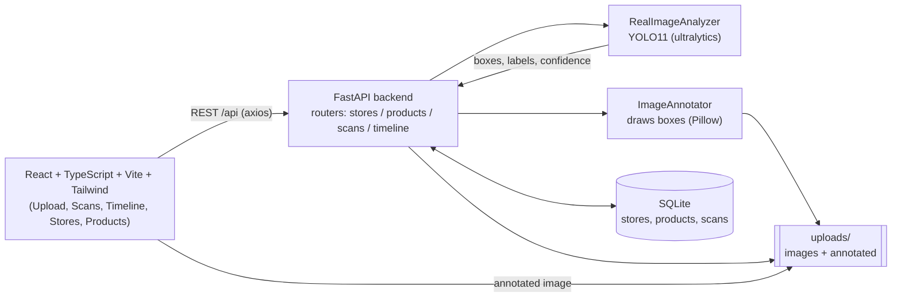

# StockSnap

Shelf-inventory counting from a photo. Upload a picture of a store shelf, and StockSnap runs a YOLO11 object detector, counts the products it finds, draws the bounding boxes on the image, and records every scan so stock levels can be charted over time.

Built at a hackathon (March-April 2026).

## What it does

- **Count products from a photo.** Upload a shelf image, pick a store and product, and get a count, an average confidence score, and an annotated image with boxes.
- **Track stock over time.** Every scan is stored in SQLite and rolled up into timeline charts and summary statistics.
- **Manage stores and products.** CRUD screens for the stores and products being tracked.
- **Dashboard.** Recent scans and headline numbers at a glance.

## Architecture



Request flow for `POST /api/scans/`: save the upload, run YOLO11, store the count and confidence in SQLite, write an annotated copy of the image, and return the scan with its detections.

## Stack

| Layer | Technology |
|-------|------------|
| Frontend | React 18, TypeScript, Vite, Tailwind CSS, Recharts, Axios, Lucide icons |
| Backend | FastAPI, Uvicorn, SQLAlchemy, Pydantic |
| Database | SQLite (created on first run) |
| Detection | Ultralytics YOLO11 (`yolo11n.pt`), OpenCV, Pillow, NumPy |

## How detection works

1. **Model.** `backend/app/services/real_image_analyzer.py` loads `yolo11n.pt` through Ultralytics. The weights are not stored in the repo; Ultralytics downloads them into `backend/weights/` the first time the server starts.
2. **Inference.** Each image is run at `imgsz=1280` with test-time augmentation, a low initial confidence floor (0.10) and class-agnostic NMS (IoU 0.3), so small and tightly packed items are not merged away.
3. **Counting.** Detections below 25% confidence are dropped. The remaining boxes are the count, and their mean confidence is the scan confidence.
4. **Annotation.** `image_annotator.py` draws every box on a copy of the photo (`uploads/annotated/`), which the UI shows next to the original.
5. **Timeline.** Each scan stores its count and timestamp. `/api/timeline/*` groups scans by day (optionally per store or product) and the Timeline page charts counts, confidence and summary stats.

If the detector cannot be loaded (for example Ultralytics is not installed), the server logs a warning and uses a built-in fallback analyzer that returns placeholder boxes, so the rest of the app can still be exercised. Counts produced that way are not real detections.

> The pretrained COCO model counts generic object classes. It is a working end-to-end pipeline, not a retail-specific model; fine-tuning on shelf-product data is the obvious next step.

## Run locally

Prerequisites: Python 3.10+ and Node 18+.

### Backend

```bash
cd backend
python -m venv .venv
# Windows:  .venv\Scripts\activate        macOS/Linux:  source .venv/bin/activate
pip install -r requirements.txt     # includes ultralytics, which pulls in PyTorch (large download)
python create_sample_data.py        # optional: demo stores, products and synthetic scan history
uvicorn app.main:app --reload --port 8000
```

API docs: http://localhost:8000/docs. On first start the YOLO11 weights (~5 MB) are downloaded automatically.

### Frontend

```bash
cd frontend
npm install
npm run dev          # http://localhost:5173 (proxies /api to :8000)
npm run build        # production build into frontend/dist
```

To point the UI at a different backend, set `VITE_API_URL` (see `frontend/.env.example`).

## Screenshots / demo

| Upload and counted boxes | Timeline | Dashboard |
|---|---|---|
| _screenshot placeholder_ | _screenshot placeholder_ | _screenshot placeholder_ |

Demo GIF: _placeholder, see [DEMO.md](DEMO.md) for how to record it._

## Repository layout

```
backend/
  app/
    main.py            FastAPI app
    routers/           stores, products, scans, timeline
    services/          real_image_analyzer (YOLO11), image_annotator, storage, mock fallback
    models/ schemas/ db/
  create_sample_data.py
  requirements.txt
frontend/
  src/pages/           Dashboard, Upload, Scans, Timeline, Stores, Products
  src/services/api.ts
```

`app/services/` also contains an experimental preprocessing / duplicate-resolution pipeline (`advanced_image_analyzer.py`, `preprocessing_pipeline.py`, `duplicate_resolver.py`). It is not wired into the API and needs extra packages (scikit-image, albumentations) that are not in `requirements.txt`.

## Roadmap

- Fine-tune on retail shelf-product data
- Authentication
- Multi-store comparison views
